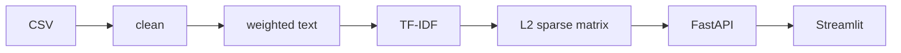

# Netflix content recommender

A content-based recommender over a Netflix movies and TV catalogue. You give it a title, or a short description of taste, and it returns similar titles with a similarity score and a one-line reason. There is no viewing history in this dataset, so it does not learn from what people watched, and it does not report an accuracy.

**Live demo:** not deployed. No Hugging Face, Render, or Fly credentials were available, so there is no public URL. Local use is below. Deployment steps are in [`deploy/README.md`](deploy/README.md).

There is no UI screenshot in the repo. `docs/screenshots/README.md` says why. The charts that do exist are the ones `scripts/evaluate.py` wrote under `reports/figures/`.

## Headline numbers

From `scripts/evaluate.py` on 27 September 2026. Full tables, intervals, and the qualitative audit are in [`reports/evaluation.md`](reports/evaluation.md). Genre precision is a proxy, not accuracy: the genre field is both a feature and the label.

| | |
| --- | --- |
| Genre precision@10 | 0.9973 (95% CI 0.9967–0.9979) |
| Random baseline precision@10 | 0.2422 (95% CI 0.2383–0.2461) |
| Jaccard@10 | 0.9580 |
| Coverage of top-10 lists | 0.8729 |
| Gini of recommendation frequency | 0.5764 |
| Intra-list diversity (mean pairwise dissimilarity) | 0.0934 |
| `recommend()` p50 / p95 | 10.24 ms / 14.92 ms |
| Artifact load in a fresh process | 899.3 ms |

The intra-list number is the honest one: a top-10 is often ten near-copies of the same genre bucket. The Irishman audit in the evaluation report is the case where the director token actually changes the list.

## Architecture



A request computes one sparse dot product against the stored matrix. The service does not build or store the full pair-similarity table.

## Quickstart

Python 3.11. On this machine that is the interpreter in `.venv` (CPython 3.11.15). `py -3.11` was not on PATH.

The catalogue CSV is already at `data/raw/netflix_titles.csv`. It was produced from `Dataset.csv.xlsx` by `scripts/prepare_raw.py`. If you only have the workbook, run that script first. If you only have the CSV, skip it.

```bash
python -m venv .venv
.venv\Scripts\python -m pip install -r requirements.txt -r requirements-dev.txt
.venv\Scripts\python scripts\train.py
.venv\Scripts\python -m pytest
.venv\Scripts\python scripts\serve.py
```

`serve.py` starts the API at <http://127.0.0.1:8000> and Streamlit at <http://127.0.0.1:8501>. The UI calls the API over HTTP. It does not import the model.

With GNU make, point `PYTHON` at the 3.11 interpreter:

```bash
make setup PYTHON=.venv/Scripts/python
make train PYTHON=.venv/Scripts/python
make test PYTHON=.venv/Scripts/python
make run PYTHON=.venv/Scripts/python
```

`make setup` only installs dependencies. `make prepare` rebuilds the CSV from the workbook.

Docker, from a clone that contains `data/raw/netflix_titles.csv`:

```bash
docker compose up --build
```

The API is on port 8000 and Streamlit on port 8501. The image trains during build, so the runtime layer does not need the CSV. The container reads `PORT`. A local `docker compose up --build` on 27 September 2026 came up healthy: `GET /health` returned `{"status":"ok"}`, `POST /recommend` for The Irishman returned Gangs of New York, and Streamlit answered HTTP 200. The built image is 944 MB. `.git` is not in the build context, so the copy of `metadata.json` inside the image records `git_commit` as `unknown`. The artifacts produced by `scripts/train.py` on the host keep the real commit.

Training on this laptop CPU took about 16 seconds from reading the CSV to writing `models/`. The artifact directory is 2,062,075 bytes.

## Layout

| Path | What it is |
| --- | --- |
| `src/data` | CSV contract, load, and the defect cleaner |
| `src/features` | Weighted text and the TF-IDF / count vectoriser |
| `src/models` | `Recommender`, save, and load |
| `src/evaluation` | Proxy metrics |
| `src/api` | FastAPI |
| `app` | Streamlit client |
| `scripts` | Profile, prepare, train, evaluate, serve |
| `tests` | Pytest against a 60-row fixture, not the full CSV |
| `reports` | Data profile, evaluation, figures |
| `docs` | Decisions, API examples, demo script |
| `deploy` | Hugging Face, Render, and Fly notes. Not applied. |
| `notebooks` | Exploration that imports `src/` |

## Model

Each title becomes one text document. Genres are collapsed into single tokens (`TV Dramas` becomes `tvdramas`) and repeated three times. Director names are collapsed the same way and repeated twice. Type, rating, and spaced genre words are included once. Country weight is 0. Cast and description are empty in this extract, so they contribute nothing. Missing text is left empty. It is never replaced with the word Unknown.

Those documents go through `TfidfVectorizer` (English stop words, word and bigram, `min_df=2`, `sublinear_tf`, float32) and then L2 normalisation, so the dot product is cosine similarity. A count vectoriser is implemented behind `vectorizer.kind` and compared in the evaluation report. The shipped setting is TF-IDF with genre weight 3. The count vectoriser scores slightly higher on genre precision and ties whole genre buckets at 1.0, which is a worse ranking even though the proxy metric likes it. See [`docs/DECISIONS.md`](docs/DECISIONS.md).

### Limitations

- No user behaviour, so no collaborative signal and no accuracy.
- No cast and no synopsis. Many lists are "other titles with the same genre string".
- Genre precision uses that same string, so a high score mostly shows the vectoriser obeyed the weights.
- 421 rows are labelled Pakistan, including titles that are not Pakistani. Country weight is 0 because of that.
- Kota Factory is tagged as an international romantic comedy in this file. The recommendations follow that tag. The tag is wrong for the show.
- Intra-list diversity is 0.0934. Lists are not varied.
- Stop words are the English list.
- Cold-start text can only match tokens that appear in the catalogue fields that exist.

## API

[`docs/API.md`](docs/API.md) has a curl and the JSON that came back for each route. OpenAPI is at `/docs` when the API is running.

| Method | Path | Role |
| --- | --- | --- |
| GET | `/health` | Process is up |
| GET | `/ready` | Artifacts loaded |
| GET | `/meta` | Training metadata and metrics |
| GET | `/titles` | Typeahead |
| GET | `/titles/{show_id}` | One row |
| POST | `/recommend` | Neighbours of a title |
| POST | `/recommend/text` | Neighbours of free text |
| GET | `/stats` | Counts for the Explore tab |
| GET | `/metrics` | Prometheus text |

Unknown titles are 404 with suggestions. Invalid `n` is 422. An out-of-vocabulary sentence is 400. Recommend routes are rate limited (`RATE_LIMIT`, default `60/minute`).

## Tests and CI

`pytest` on 27 September 2026: 44 passed, 88.77% line coverage on `src/` (gate is 80%). `ruff check`, `black --check`, and `mypy src/` are the lint gate. The workflow is [`.github/workflows/ci.yml`](.github/workflows/ci.yml). It has not been run on GitHub from this working tree, so the README has no status badge. A badge for a workflow that has not run would be empty or red.

The suite uses `tests/fixtures/mini_netflix.csv` only. It does not download the catalogue.

## Environment

See [`.env.example`](.env.example).

| Variable | Role |
| --- | --- |
| `API_BASE_URL` | Where Streamlit sends requests. Default `http://localhost:8000`. In Compose, `http://api:8000`. |
| `PORT` | Listen port. Platforms inject this. |
| `UI_PORT` | Streamlit port for `scripts/serve.py`. Default 8501. |
| `CORS_ORIGINS` | Comma-separated browser origins. Default localhost:8501. |
| `RATE_LIMIT` | slowapi limit on the recommend routes. |
| `LOG_LEVEL` | Log level. |
| `MODELS_DIR` | Optional artifact directory. |

No secrets are required.

## What I would do next

Once interaction data exists, add collaborative filtering and a hybrid re-ranker, and evaluate with a held-out watch or rating rather than genre overlap. Sentence-transformer embeddings would use a synopsis if one is added to the extract. An A/B framework would test whether the franchise filter and the genre weight change what people click. None of that is in this repo, because the data for it is not here.
