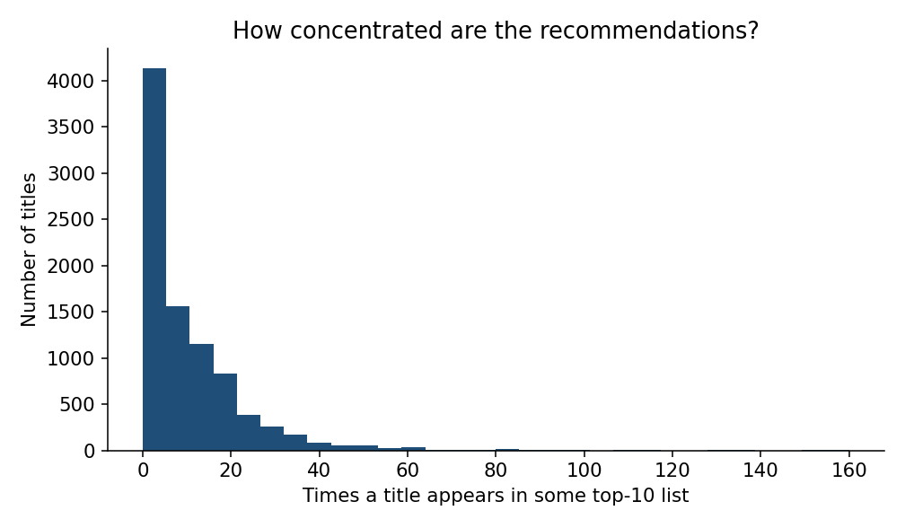
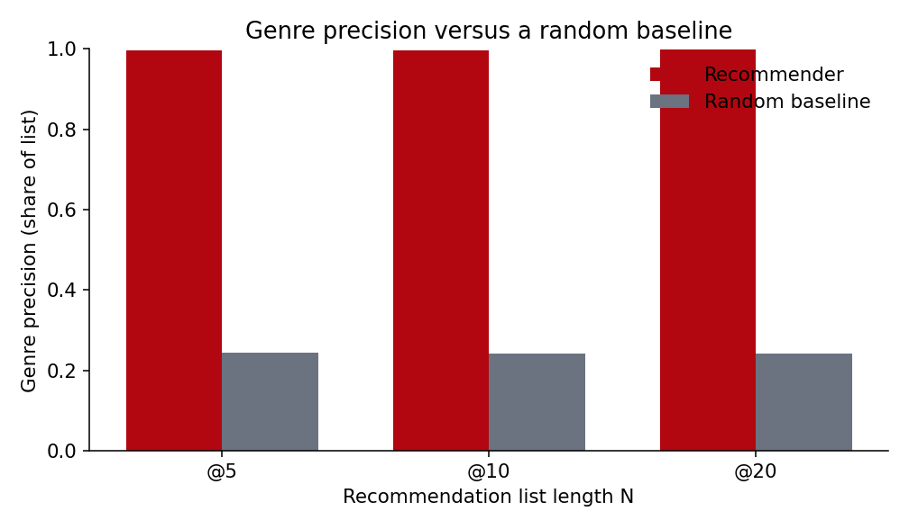
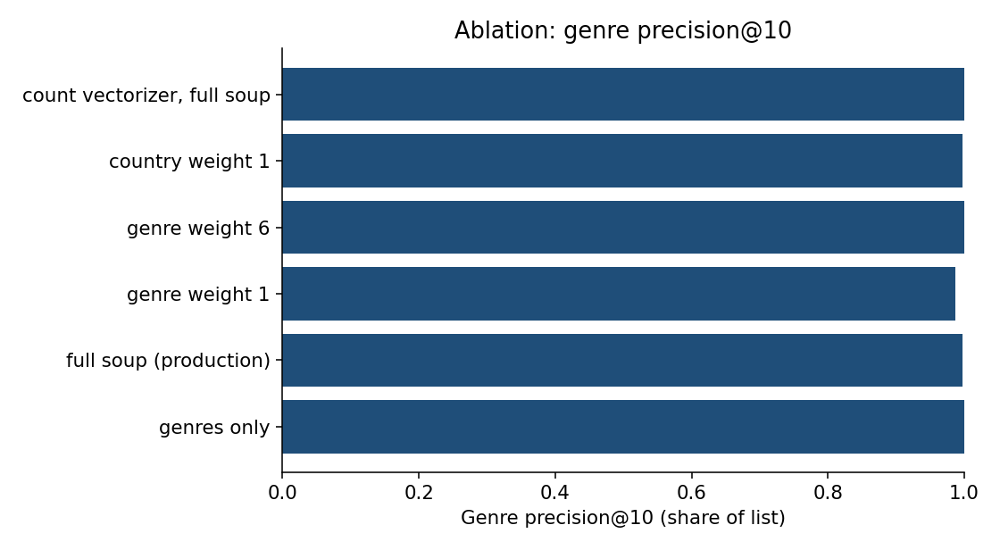

# Evaluation

Generated by `scripts/evaluate.py` from the artifacts in `models/`.
Re-run the script to refresh every number in this file.

## What this is not

The catalogue has no user interactions, no ratings of preference, and no
held-out relevance labels. **Genre precision is not accuracy.** Genres are
also the strongest feature in the soup, so a high genre precision mostly
shows that the vectoriser did what it was asked to do. It is a sanity check
against a random baseline, not an estimate of whether a person would enjoy
the recommendation. `cast` and `description` are absent from this extract,
so many titles are similar only because they share genre tokens.

## Genre agreement

For every title, take the top N recommendations (franchise filter on, which
is the product default) and average over the catalogue. Intervals are
percentile bootstrap 95% CIs with 1000 resamples
and seed 42.

| N | genre precision | 95% CI | random precision | random 95% CI | Jaccard | Jaccard 95% CI | random Jaccard |
| --- | --- | --- | --- | --- | --- | --- | --- |
| 5 | 0.9969 | 0.9962–0.9975 | 0.2437 | 0.2389–0.2485 | 0.9666 | 0.9648–0.9684 | 0.0926 |
| 10 | 0.9973 | 0.9967–0.9979 | 0.2422 | 0.2383–0.2461 | 0.9580 | 0.9559–0.9601 | 0.0921 |
| 20 | 0.9977 | 0.9972–0.9980 | 0.2421 | 0.2387–0.2457 | 0.9388 | 0.9363–0.9414 | 0.0922 |

## Coverage and diversity

Computed from each title's top 10.

- coverage (share of the catalogue that appears at least once): **0.8729**
- Gini of the recommendation-frequency distribution (0 equal, 1 concentrated): **0.5764**
- intra-list diversity (mean pairwise cosine dissimilarity inside a top-10): **0.0934**

## Ablation

Same metric, whole catalogue, franchise filter on. Production weights are
the `feature_weights` block in `config.yaml` (country weight 0). Description-only
has almost nothing to fit because this extract has no `description` column.

| configuration | genre precision@10 | Jaccard@10 | note |
| --- | --- | --- | --- |
| description only | n/a | n/a | Vectorizer produced no vocabulary. The documents are empty or every token was removed by stop words / min_df. |
| genres only | 1.0000 | 0.9674 |  |
| full soup (production) | 0.9973 | 0.9580 |  |
| genre weight 1 | 0.9875 | 0.9134 |  |
| genre weight 6 | 0.9997 | 0.9657 |  |
| country weight 1 | 0.9973 | 0.9573 |  |
| count vectorizer, full soup | 1.0000 | 0.9699 |  |

The genres-only row is the useful comparison: if it matches the full soup,
the other fields are not moving genre precision (which is expected when genre
precision is computed from the same field the model was shown). Country weight 1
is the sensitivity check for the corrupted Pakistan labels. Count versus TF-IDF
is the second vectoriser. See `docs/DECISIONS.md` for the weight that is shipped.

## Qualitative audit

Top 5 with the franchise filter on. Verdicts are stored in
`reports/qualitative_verdicts.json` after reading these lists; they are judgements,
not computed scores.

### Breaking Bad

| rank | title | type | year | similarity | genres | reason |
| --- | --- | --- | --- | --- | --- | --- |
| 1 | Ozark | TV Show | 2020 | 1.000 | Crime TV Shows, TV Dramas, TV Thrillers | Because both are Crime TV Shows, TV Dramas and TV Thrillers. |
| 2 | The Assassination of Gianni Versace | TV Show | 2018 | 1.000 | Crime TV Shows, TV Dramas, TV Thrillers | Because both are Crime TV Shows, TV Dramas and TV Thrillers. |
| 3 | Dare Me | TV Show | 2019 | 1.000 | Crime TV Shows, TV Dramas, TV Thrillers | Because both are Crime TV Shows, TV Dramas and TV Thrillers. |
| 4 | Designated Survivor | TV Show | 2019 | 1.000 | Crime TV Shows, TV Dramas, TV Thrillers | Because both are Crime TV Shows, TV Dramas and TV Thrillers. |
| 5 | The Lizzie Borden Chronicles | TV Show | 2015 | 0.962 | Crime TV Shows, TV Dramas, TV Thrillers | Because both are Crime TV Shows, TV Dramas and TV Thrillers. |

Verdict: Genre-bucket tie. Ozark is a fair crime-drama neighbour; Dare Me and Designated Survivor are not. With no cast and no synopsis, every Crime / TV Drama / TV Thriller series scores 1.0, and Better Call Saul never reaches the top 5.

### The Irishman

| rank | title | type | year | similarity | genres | reason |
| --- | --- | --- | --- | --- | --- | --- |
| 1 | Gangs of New York | Movie | 2002 | 1.000 | Dramas | Because both are Dramas and share Martin Scorsese. |
| 2 | Hugo | Movie | 2011 | 0.593 | Children & Family Movies, Dramas | Because both are Dramas and share Martin Scorsese. |
| 3 | GoodFellas | Movie | 1990 | 0.559 | Classic Movies, Dramas | Because both are Dramas and share Martin Scorsese. |
| 4 | The Departed | Movie | 2006 | 0.555 | Dramas, Thrillers | Because both are Dramas and share Martin Scorsese. |
| 5 | Shutter Island | Movie | 2010 | 0.534 | Thrillers | Because share Martin Scorsese. |

Verdict: The list that works. Scorsese dramas lead (Gangs of New York, GoodFellas, The Departed). Hugo is pulled in by the shared director even though it is a family film, which is the director weight doing what it was asked.

### Stranger Things

| rank | title | type | year | similarity | genres | reason |
| --- | --- | --- | --- | --- | --- | --- |
| 1 | Chilling Adventures of Sabrina | TV Show | 2020 | 1.000 | TV Horror, TV Mysteries, TV Sci-Fi & Fantasy | Because both are TV Horror, TV Mysteries and TV Sci-Fi & Fantasy. |
| 2 | Nightflyers | TV Show | 2018 | 0.970 | TV Horror, TV Mysteries, TV Sci-Fi & Fantasy | Because both are TV Horror, TV Mysteries and TV Sci-Fi & Fantasy. |
| 3 | Helix | TV Show | 2015 | 0.970 | TV Horror, TV Mysteries, TV Sci-Fi & Fantasy | Because both are TV Horror, TV Mysteries and TV Sci-Fi & Fantasy. |
| 4 | The 4400 | TV Show | 2007 | 0.618 | TV Dramas, TV Mysteries, TV Sci-Fi & Fantasy | Because both are TV Mysteries and TV Sci-Fi & Fantasy. |
| 5 | The Messengers | TV Show | 2015 | 0.618 | TV Dramas, TV Mysteries, TV Sci-Fi & Fantasy | Because both are TV Mysteries and TV Sci-Fi & Fantasy. |

Verdict: Same three-genre tie: TV Horror, TV Mysteries, TV Sci-Fi & Fantasy. Sabrina, Nightflyers and Helix are adjacent horror-sci-fi shows, not a Duffer-brothers cluster. The director field does not carry that signal here.

### Kota Factory

| rank | title | type | year | similarity | genres | reason |
| --- | --- | --- | --- | --- | --- | --- |
| 1 | Queen of No Marriage | TV Show | 2009 | 1.000 | International TV Shows, Romantic TV Shows, TV Comedies | Because both are International TV Shows, Romantic TV Shows and TV Comedies. |
| 2 | The Womanizer | TV Show | 2010 | 1.000 | International TV Shows, Romantic TV Shows, TV Comedies | Because both are International TV Shows, Romantic TV Shows and TV Comedies. |
| 3 | Run On | TV Show | 2020 | 1.000 | International TV Shows, Romantic TV Shows, TV Comedies | Because both are International TV Shows, Romantic TV Shows and TV Comedies. |
| 4 | Home for Christmas | TV Show | 2020 | 1.000 | International TV Shows, Romantic TV Shows, TV Comedies | Because both are International TV Shows, Romantic TV Shows and TV Comedies. |
| 5 | Little Things | TV Show | 2019 | 1.000 | International TV Shows, Romantic TV Shows, TV Comedies | Because both are International TV Shows, Romantic TV Shows and TV Comedies. |

Verdict: The catalogue tags this as International TV Shows, Romantic TV Shows and TV Comedies, so the neighbours are other international romantic comedies. That is the wrong shelf for a coaching-institute drama. The labels are wrong; the model followed them.

### Our Planet

| rank | title | type | year | similarity | genres | reason |
| --- | --- | --- | --- | --- | --- | --- |
| 1 | Penguin Town | TV Show | 2021 | 0.817 | Docuseries, Science & Nature TV | Because both are Docuseries and Science & Nature TV. |
| 2 | The Pyramid Code | TV Show | 2009 | 0.817 | Docuseries, Science & Nature TV | Because both are Docuseries and Science & Nature TV. |
| 3 | Great Yellowstone Thaw | TV Show | 2017 | 0.817 | Docuseries, Science & Nature TV | Because both are Docuseries and Science & Nature TV. |
| 4 | Nature: Animals With Cameras | TV Show | 2018 | 0.817 | Docuseries, Science & Nature TV | Because both are Docuseries and Science & Nature TV. |
| 5 | One Strange Rock | TV Show | 2018 | 0.817 | Docuseries, Science & Nature TV | Because both are Docuseries and Science & Nature TV. |

Verdict: Mostly the right shelf: Penguin Town, Great Yellowstone Thaw, Nature: Animals With Cameras and One Strange Rock. The Pyramid Code shares the same two genres and ties with them, which is a miss. Scores are tied because the genre pair is the whole signal.

### Klaus

| rank | title | type | year | similarity | genres | reason |
| --- | --- | --- | --- | --- | --- | --- |
| 1 | A Cinderella Story | Movie | 2004 | 1.000 | Children & Family Movies, Comedies | Because both are Children & Family Movies and Comedies. |
| 2 | George of the Jungle 2 | Movie | 2003 | 1.000 | Children & Family Movies, Comedies | Because both are Children & Family Movies and Comedies. |
| 3 | G-Force | Movie | 2009 | 1.000 | Children & Family Movies, Comedies | Because both are Children & Family Movies and Comedies. |
| 4 | Beethoven's 2nd | Movie | 1993 | 1.000 | Children & Family Movies, Comedies | Because both are Children & Family Movies and Comedies. |
| 5 | Little Monsters | Movie | 1989 | 1.000 | Children & Family Movies, Comedies | Because both are Children & Family Movies and Comedies. |

Verdict: Tagged only as Children & Family Movies and Comedies, so it ties with Beethoven's 2nd and other kids comedies at 1.0. Nothing in the row says Christmas or animation, because this extract has no description.

### ROMA

| rank | title | type | year | similarity | genres | reason |
| --- | --- | --- | --- | --- | --- | --- |
| 1 | Y Tu Mamá También | Movie | 2001 | 1.000 | Dramas, Independent Movies, International Movies | Because both are Dramas, Independent Movies and International Movies and share Alfonso Cuarón. |
| 2 | Solo Con Tu Pareja | Movie | 1991 | 0.717 | Comedies, Independent Movies, International Movies | Because both are Independent Movies and International Movies and share Alfonso Cuarón. |
| 3 | A Little Chaos | Movie | 2014 | 0.675 | Dramas, Independent Movies, International Movies | Because both are Dramas, Independent Movies and International Movies. |
| 4 | The Pianist | Movie | 2002 | 0.675 | Dramas, Independent Movies, International Movies | Because both are Dramas, Independent Movies and International Movies. |
| 5 | Ex Machina | Movie | 2015 | 0.675 | Dramas, Independent Movies, International Movies | Because both are Dramas, Independent Movies and International Movies. |

Verdict: Cuarón's own films lead (Y Tu Mamá También, Solo Con Tu Pareja). After that, Independent / International / Drama is a large hub, so The Pianist and Ex Machina tie. The director token is the useful part.

### Hasan Minhaj: Homecoming King

| rank | title | type | year | similarity | genres | reason |
| --- | --- | --- | --- | --- | --- | --- |
| 1 | Jeff Garlin: Our Man In Chicago | Movie | 2019 | 1.000 | Stand-Up Comedy | Because both are Stand-Up Comedy and share Christopher Storer. |
| 2 | Bo Burnham: what. | Movie | 2013 | 0.584 | Stand-Up Comedy | Because both are Stand-Up Comedy and share Christopher Storer. |
| 3 | Joaquín Reyes: Una y no más | Movie | 2017 | 0.571 | Stand-Up Comedy | Because both are Stand-Up Comedy. |
| 4 | Fabrizio Copano: Solo pienso en mi | Movie | 2017 | 0.571 | Stand-Up Comedy | Because both are Stand-Up Comedy. |
| 5 | Fary Is the New Black | Movie | 2018 | 0.571 | Stand-Up Comedy | Because both are Stand-Up Comedy. |

Verdict: Stand-up specials, with Christopher Storer (director of several Netflix specials) pulling Jeff Garlin and Bo Burnham ahead of the rest of the stand-up bucket. Sensible for a special, not a signal about Minhaj's writing.

## Franchise filter

Breaking Bad's top 5 does not move when the filter is turned off. Better Call Saul
and El Camino do not share its exact genre triple, so other crime dramas outrank them
before the franchise rule ever runs.

### Breaking Bad, filter off

| rank | title | type | year | similarity | genres | reason |
| --- | --- | --- | --- | --- | --- | --- |
| 1 | Ozark | TV Show | 2020 | 1.000 | Crime TV Shows, TV Dramas, TV Thrillers | Because both are Crime TV Shows, TV Dramas and TV Thrillers. |
| 2 | The Assassination of Gianni Versace | TV Show | 2018 | 1.000 | Crime TV Shows, TV Dramas, TV Thrillers | Because both are Crime TV Shows, TV Dramas and TV Thrillers. |
| 3 | Dare Me | TV Show | 2019 | 1.000 | Crime TV Shows, TV Dramas, TV Thrillers | Because both are Crime TV Shows, TV Dramas and TV Thrillers. |
| 4 | Designated Survivor | TV Show | 2019 | 1.000 | Crime TV Shows, TV Dramas, TV Thrillers | Because both are Crime TV Shows, TV Dramas and TV Thrillers. |
| 5 | The Lizzie Borden Chronicles | TV Show | 2015 | 0.962 | Crime TV Shows, TV Dramas, TV Thrillers | Because both are Crime TV Shows, TV Dramas and TV Thrillers. |

The filter does change a sequel-heavy title. `Naruto Shippuden: The Movie` shares a
long normalised prefix with `Naruto Shippuden the Movie: Bonds`, so the default
filter drops that near-duplicate. The earlier Naruto films do not share a 10-character
prefix with the Shippuden title, so they stay.

### Naruto Shippuden: The Movie, filter on

| rank | title | type | year | similarity | genres | reason |
| --- | --- | --- | --- | --- | --- | --- |
| 1 | Naruto the Movie 3: Guardians of the Crescent Moon Kingdom | Movie | 2006 | 0.807 | Action & Adventure, Anime Features, International Movies | Because both are Action & Adventure, Anime Features and International Movies. |
| 2 | Naruto the Movie 2: Legend of the Stone of Gelel | Movie | 2005 | 0.807 | Action & Adventure, Anime Features, International Movies | Because both are Action & Adventure, Anime Features and International Movies. |
| 3 | No Game No Life: Zero | Movie | 2017 | 0.760 | Action & Adventure, Anime Features, International Movies | Because both are Action & Adventure, Anime Features and International Movies. |
| 4 | Altered Carbon: Resleeved | Movie | 2020 | 0.760 | Action & Adventure, Anime Features, International Movies | Because both are Action & Adventure, Anime Features and International Movies. |
| 5 | New Gods: Nezha Reborn | Movie | 2021 | 0.759 | Action & Adventure, Anime Features, International Movies | Because both are Action & Adventure, Anime Features and International Movies. |

### Naruto Shippuden: The Movie, filter off

| rank | title | type | year | similarity | genres | reason |
| --- | --- | --- | --- | --- | --- | --- |
| 1 | Naruto Shippûden the Movie: Bonds | Movie | 2008 | 1.000 | Action & Adventure, Anime Features, International Movies | Because both are Action & Adventure, Anime Features and International Movies and share Hajime Kamegaki. |
| 2 | Naruto the Movie 3: Guardians of the Crescent Moon Kingdom | Movie | 2006 | 0.807 | Action & Adventure, Anime Features, International Movies | Because both are Action & Adventure, Anime Features and International Movies. |
| 3 | Naruto the Movie 2: Legend of the Stone of Gelel | Movie | 2005 | 0.807 | Action & Adventure, Anime Features, International Movies | Because both are Action & Adventure, Anime Features and International Movies. |
| 4 | No Game No Life: Zero | Movie | 2017 | 0.760 | Action & Adventure, Anime Features, International Movies | Because both are Action & Adventure, Anime Features and International Movies. |
| 5 | Altered Carbon: Resleeved | Movie | 2020 | 0.760 | Action & Adventure, Anime Features, International Movies | Because both are Action & Adventure, Anime Features and International Movies. |

## Latency

Timed `1000` calls to `recommend()` using randomly
chosen `show_id` values (seed 42), franchise filter on, N=10. show_id is unique; a few display titles are not.

- p50: **10.24 ms**
- p95: **14.92 ms**
- cold artifact load in a fresh process: **899.3 ms**

Budget for p95 is 200 ms.
